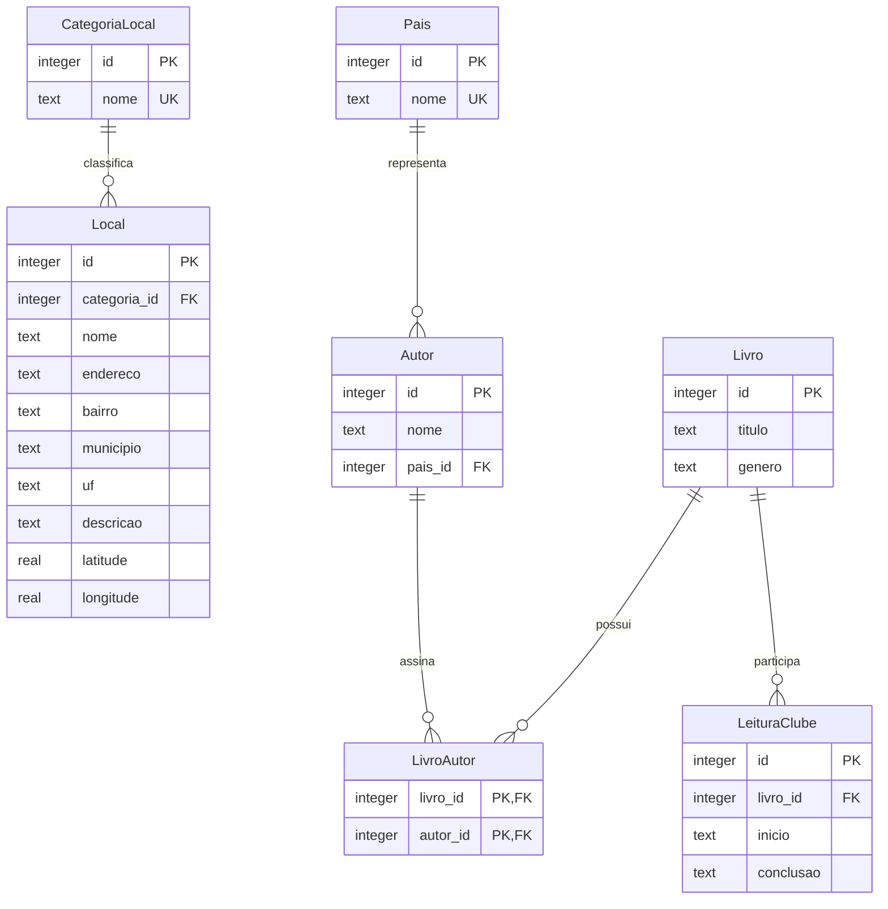

# Modelo relacional do Lendo pelo Mundo

O guia usa endereço e categoria para localizar espaços de leitura. Livros e autores fazem parte do histórico do clube. Cada leitura representa uma ocasião, inclusive quando o clube relê uma obra. Cada autor tem um país de referência.

Coordenadas são opcionais em par. A ausência da data de conclusão identifica uma leitura em andamento. A contagem por país usa o identificador da leitura, o que preserva releituras e evita duplicação por coautores do mesmo país.
